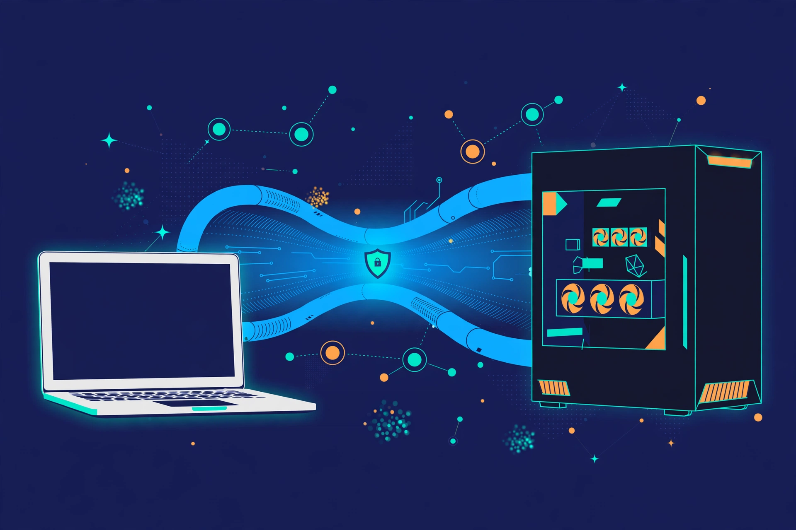
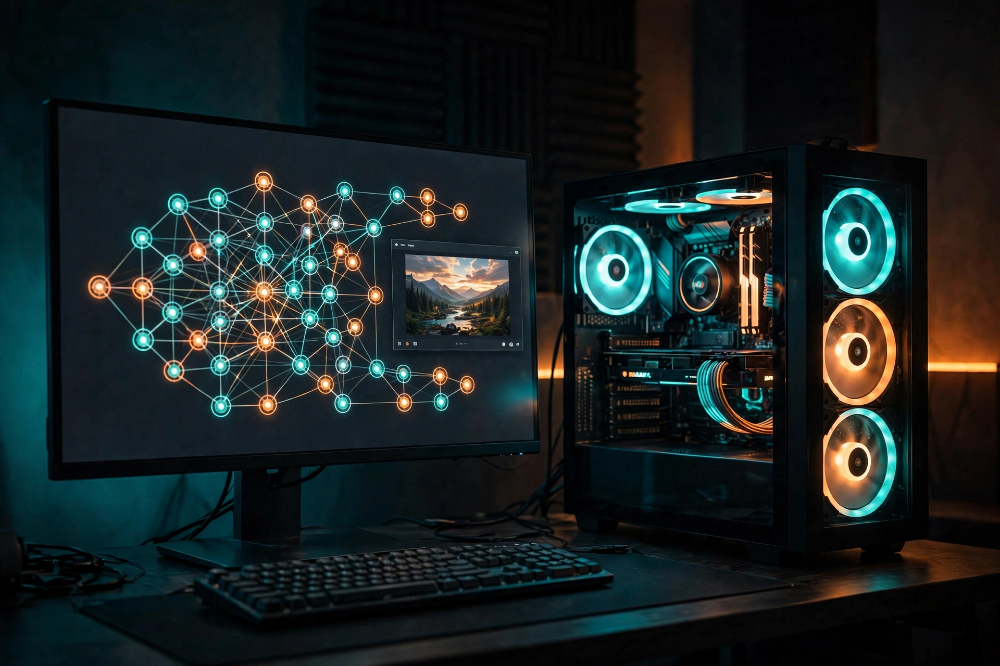
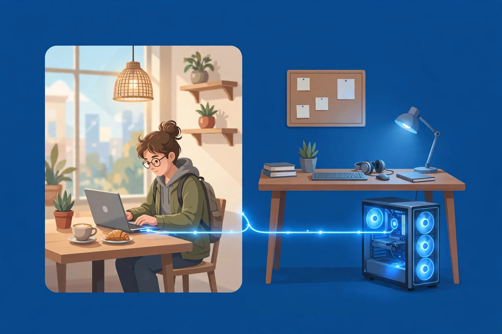
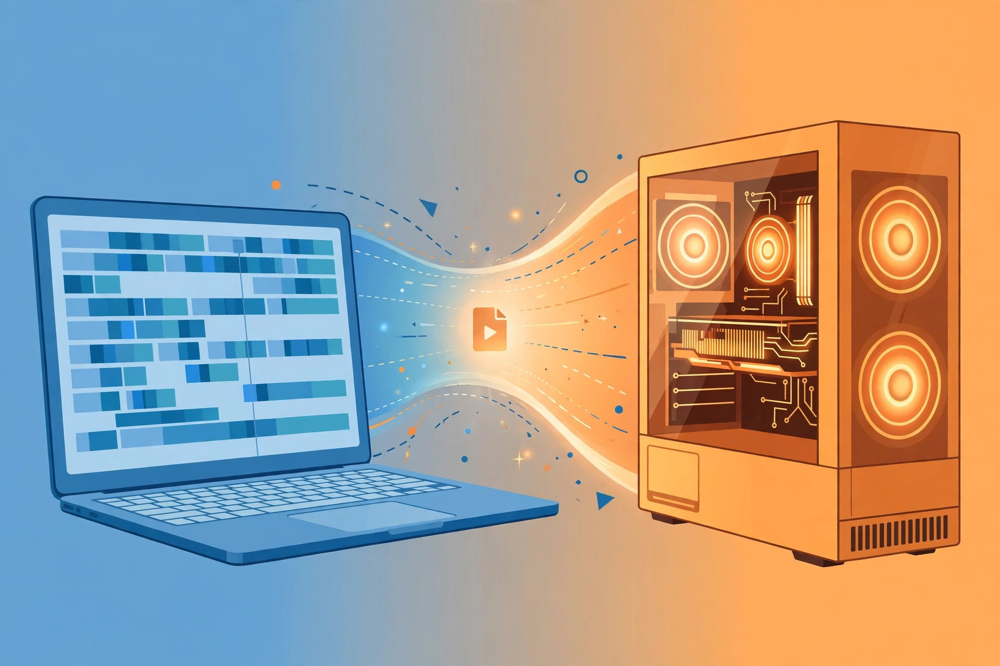
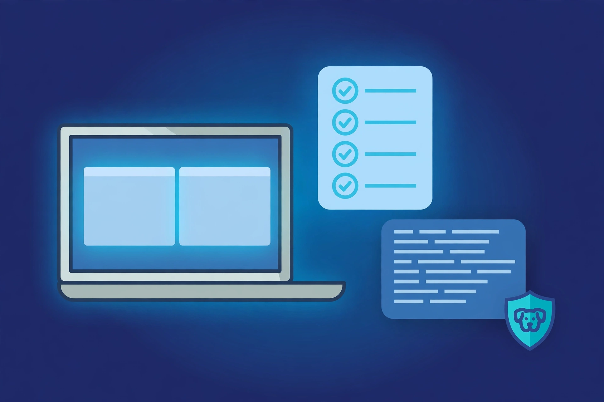

# Mac + AI 助手直连 Windows：远程操控、ComfyUI 局域网与 MiniMax H3 本地生视频工具包


让一台 Windows 电脑 24 小时开机待命：人在 Mac 上远程桌面操作它，AI 助手用 SSH 直接操作它（启停服务、跑 ComfyUI、传文件），在家里走局域网、在外面走 Tailscale 加密通道，**全程不暴露任何公网端口**。上面跑的是 MiniMax H3，本地生视频：16G 显存走 INT8 量化就能跑，1280×736、5 秒已跑通（步骤见 `docs/h3-deployment.md`）。

这套配置 2026-10-20 ~ 2026-10-21 实战搭建、逐项实测通过，所有踩过的坑都记进了 `docs/troubleshooting.md`。



## 搭好后你得到什么

- **Windows 电脑 24 小时待命**：ComfyUI 后端随登录自动启动，每 5 分钟有看门狗自检，挂了自动拉起。
- **人在家**：Mac 上双击远程桌面直连 Windows；浏览器打开 `http://<Windows 局域网 IP>:8188` 就是 ComfyUI。
- **人在外面**：Mac 先连上 Tailscale，远程桌面和 ComfyUI 网页照常用（地址换成 Tailscale 的 100.x 地址），和在家没有区别。
- **AI 助手**：通过 SSH（走 Tailscale）直接在 Windows 上执行命令、启停 ComfyUI 后端、提交生成任务、取回成片——不需要你守在电脑前，也不需要经过 Mac 中转。
- **本地跑 MiniMax H3 生视频**：ComfyUI + INT8 量化，1280×736、5 秒已跑通；R2V 换人走两段式（步骤见 `docs/h3-deployment.md`）。
- **安全**：没有任何端口暴露在公网上。所有通道只在「你的局域网」和「你自己的 Tailscale 私有网络」里开放。



## 为什么这么做（优势）


- **轻的归轻、重的归重**：Mac 只负责操作，Windows 的显卡跑重活，Mac 不发热、不卡、不掉电。
- **在家在外一个样**：Tailscale 打通后，出差、咖啡厅和家里是同一套操作，不用再带两台电脑。
- **24 小时待命**：后端开机自启、每 5 分钟看门狗巡逻，半夜提交任务，早上起来收成片。
- **助手能直接干活**：SSH 直连，报错只说一句「报错了」，不用守在电脑前。
- **零公网暴露**：不做端口映射，全部只在局域网和自己的 Tailscale 网络里。
- **一份模型两边用**：模型目录用目录联接指到共享盘，Desktop 和手动后端共用同一套，不占两份磁盘。

## 适用场景



- **本地跑 AI 视频 / 图片生成**：ComfyUI、视频模型这种吃显存的活，Mac 跑不动、云端按量又贵，家里有张显卡就别浪费。
- **经常出差、但重活离不开台式机**：轻装出门，算力留在家里。
- **Mac 剪辑、Windows 渲染的分工**：小样在 Mac 上出，正式版扔给 Windows 慢慢渲，Mac 继续剪下一条。
- **想让 AI 助手半夜替你干活**：任务发过去，早上验收就行。

## 本地部署 MiniMax H3


MiniMax H3（2026 年 8 月开源，约 33B，全模态、原生带音频）：本地开源的只有 H3-Base，输出上限约 768p；想出 2K 得走官方 API。

- 硬件：16G 显存 + 32G 内存走 INT8 量化能跑，1280×736、5 秒已跑通；M 系列 428B 即使 64G 内存也扛不动，本地视频主力就是 H3。
- 部署：ComfyUI Desktop 点 H3 的 T2V 模板，约 53GB 模型一次下完；R2V 另下 ref2va 模型约 19GB + turbo LoRA 约 1.82GB。
- 定论：分辨率定 0.9（1280×736），步数原生固定 20 步；R2V 的 ref_video 是 IMAGE 不是 VIDEO；换人必须两段式。



- 渲染分工：小样 Mac 本地出，批量长段扔 Windows 并行渲，最终定稿回 Mac；NVENC 实测比 Mac 快约 1.4–1.5 倍，但隧道传 30MB 要 2–5 分钟，小文件来回传反而更慢。

完整步骤、耗时实测与坑见 `docs/h3-deployment.md`。

## 注意点与弊端

- **Windows 得 24 小时开机**：电费、风扇声、系统更新一重启服务就断，得自己兜着。
- **单点故障**：主机一挂全断；单盘没冗余，数据得自己备份。
- **远程毕竟不是本地**：RDP 会顶掉本机会话，画质和延迟都差一截；文件不能跨桌面直接粘贴，得走文件夹重定向。
- **Tailscale 是命脉**：账号丢了等于全套重建；免费版设备数也有限。
- **跨网传大文件慢**：在外用流量传几十 MB 的成片不现实，重活还是得回家收。
- **首次搭建有门槛**：Tailscale、SSH 密钥、防火墙、计划任务，任何一步卡住都得排障——不过本仓库的 `AGENTS.md` 就是干这个的，让 agent 代劳。

## 用法一：交给 AI Agent（推荐）

把这个仓库发给你的 agent，再发下面这段启动词，它会按阶段自检、安装、验收，只有登录、授权、设密码等少数动作需要你本人点几下：

> 请阅读这个仓库里的《AGENTS.md》，按阶段顺序在我的电脑上完成配置。先只做阶段 A 的环境自检，把报告给我看，我确认后再继续。需要我本人操作的步骤，停下来一步一步告诉我点哪里。全程按手册的验收标准自检，做完一个阶段向我汇报一次。

- **Claude Code、Codex、Antigravity**：会自动读取仓库根目录的 `AGENTS.md`，直接开干。
- **LobsterAI**：基于 OpenClaw，工作区里的 `AGENTS.md` 会按 OpenClaw 的机制自动读入，把本仓库的 `AGENTS.md` 放进它的工作区即可。
- **Grok Bot、豆包工作、WorkBuddy**：把 `AGENTS.md` 全文发给它，再附上上面这段启动词。

## 用法二：手动搭建

通读 `docs/setup-guide.md`（第 0 章先看懂全貌），按第 2 章 → 第 7 章顺序操作；出问题先查 `docs/troubleshooting.md`，按症状找解法。

最短路径：

1. 两台机器装 Tailscale，用**同一个账号**登录。
2. 把整个仓库拷到 Windows 电脑，管理员 PowerShell 里运行 `scripts/setup-windows.ps1`，按提示贴入助手的 SSH 公钥、在本机给远程专用账号设密码。
3. 按 `docs/setup-guide.md` 第 6、7 章在 Mac 上装 Windows App、保存并绑定凭据、挂一个文件夹做文件传输通道。
4. 按 `docs/setup-guide.md` 第 9 章逐项验收打勾。

## 仓库结构

```
mac-windows-remote-toolkit/
├── README.md                  # 你正在读的这份：总览与两种用法
├── AGENTS.md                  # 给 agent 读的执行手册（阶段 A→F + 启动词）
├── LICENSE                    # MIT
├── assets/                    # 配图（封面、架构、ComfyUI 远程、工具包、优势、场景、H3 生成、H3 渲染）
├── docs/
│   ├── setup-guide.md         # 配置文档：从零到跑通的每一步与排障
│   ├── troubleshooting.md     # 故障速查台账：全部踩坑记录（症状 → 根因 → 解法）
│   └── h3-deployment.md       # H3 部署：MiniMax H3 本地部署 + Mac/Windows 渲染分工
└── scripts/
    ├── setup-windows.ps1      # Windows 一键配置（OpenSSH、RDP、自启、看门狗、防火墙收口）
    ├── comfy-backend.ps1      # ComfyUI 后端核心控制脚本（start / stop / status）
    ├── enable-lan-mode.bat    # 一键进入局域网模式（端口转发 + 模型联接 + 启动后端）
    ├── restore-desktop-mode.bat # 退出局域网模式，回到纯 ComfyUI Desktop
    ├── start-comfyui-backend.bat # 桌面手动按钮：启动后端
    └── stop-comfyui-backend.bat  # 桌面手动按钮：关闭后端
```



## 安全边界

- 所有入口只在局域网和你自己的 Tailscale 网络内开放，**没有任何公网端口映射**。
- SSH 只用密钥登录；远程桌面用独立的本地账号，不用微软账号密码、更不用 PIN。
- 想撤销助手的访问：删掉 Tailscale 设备、停用 OpenSSH 服务、或删掉公钥文件里的一行，任选其一立即生效（见 `docs/setup-guide.md` 第 10 章）。

## 前置条件与降级

- **Windows 电脑**：Windows 10/11 **专业版**（远程桌面被连接需要专业版；家庭版只能连别人、不能被连）。家庭版降级方案见 `AGENTS.md` 阶段 A：少掉的只有「远程桌面」一项，SSH 直连、ComfyUI 网页操控、自启与看门狗都可照常装。
- **Mac**：能装 App Store 应用即可。
- **一个 Tailscale 账号**：免费版足够（3 台设备以内免费额度够用）。务必用你能长期登录、且本身开了双重验证的账号——它就是整套通道的钥匙。
- **ComfyUI Desktop**（可选，只要远程操控电脑可以跳过相关章节）：已安装并能本地正常打开。

## 不包含什么

- **ComfyUI 本体与模型文件**：请从官网安装 ComfyUI Desktop、自行下载模型。本仓库只含配置与控制脚本。

## 报错协议

任何桌面工具（`.bat`）执行失败，窗口会明确写出失败步骤和原因，并把全过程记进同目录的日志文件。你什么都不用做，在聊天里对助手说一句 **「报错了」**，助手会自己去读日志定位修复——不要自己反复双击重试。

## License

MIT — 见 [LICENSE](LICENSE)。
