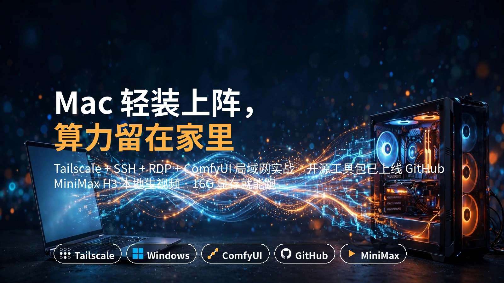

# Mac + AI 助手直连 Windows：远程操控、ComfyUI 局域网与 MiniMax H3 本地生视频工具包



**Linger 本地推理** · [Mac 和 Windows 独立配置、模型选择、一键安装及 Agent 手册](linger/README.md)

让一台 Windows 电脑 24 小时开机待命：人在 Mac 上远程桌面操作它，AI 助手用 SSH 直接操作它（启停服务、跑 ComfyUI、传文件），在家里走局域网、在外面走 Tailscale 加密通道，**路由器保持无公网端口映射**。ComfyUI 局域网与 Tailnet 入口为 8188，由 Windows 主机内的 portproxy 转发至后端 8189。

2026-10-20 ~ 2026-10-21 的搭建与故障记录见 `docs/troubleshooting.md`，历史记录显示 2026-10-27 后 8188 曾无响应。2026-11-19 15:05（Asia/Shanghai，CST），Mac 经 Tailscale 访问 8188，首页和 `/system_stats` 均返回 HTTP 200。Windows 本机 8189、portproxy 内部配置、工作流与模型生成均未验证。

## 搭好后你得到什么

- **Windows 电脑 24 小时待命**：ComfyUI 后端随登录自动启动，每 5 分钟有看门狗自检，挂了自动拉起。
- **人在家**：Mac 上双击远程桌面直连 Windows；浏览器打开 `http://<Windows 局域网 IP>:8188` 就是 ComfyUI。
- **人在外面**：Mac 先连上 Tailscale，远程桌面和 ComfyUI 网页照常用（地址换成 Tailscale 的 100.x 地址），和在家没有区别。
- **AI 助手**：通过 SSH（走 Tailscale）直接在 Windows 上执行命令、启停 ComfyUI 后端、提交生成任务、取回成片——不需要你守在电脑前，也不需要经过 Mac 中转。
- **本地视频工作流**见 [H3 部署说明](docs/h3-deployment.md)，模型来源、硬件门槛与复现条件待核。
- **访问范围**：按配置指南核验生效的入站规则，限定到所需的局域网与 Tailnet 来源。

## 为什么这么做（优势）

- **轻的归轻、重的归重**：Mac 只负责操作，Windows 的显卡跑重活，Mac 不发热、不卡、不掉电。
- **在家在外一个样**：Tailscale 打通后，出差、咖啡厅和家里是同一套操作，不用再带两台电脑。
- **后台运行**：后端在任务绑定账号登录时启动，看门狗每 5 分钟尝试补启动，恢复结果以 HTTP 验活为准。
- **助手能直接干活**：SSH 直连，报错只说一句「报错了」，不用守在电脑前。
- **内网入口**：Windows 主机内的 portproxy 用于转发 8188，路由器保持无公网端口映射。
- **一份模型两边用**：模型目录用目录联接指到共享盘，Desktop 和手动后端共用同一套，不占两份磁盘。

## 适用场景

- **本地跑 AI 视频 / 图片生成**：ComfyUI、视频模型这种吃显存的活，Mac 跑不动、云端按量又贵，家里有张显卡就别浪费。
- **经常出差、但重活离不开台式机**：轻装出门，算力留在家里。
- **Mac 剪辑、Windows 渲染的分工**：小样在 Mac 上出，正式版扔给 Windows 慢慢渲，Mac 继续剪下一条。
- **想让 AI 助手半夜替你干活**：后台提交后用队列与日志追踪。登录自启和看门狗依赖交互式会话，看门狗只检查端口。

## 本地部署 MiniMax H3

仓库沿用 MiniMax H3 作为工作流称呼，正式模型名称、规格和下载来源待核。既有主机快照为 32 GB 物理内存，另有约 44 GB 占用记录，指标、范围和时间均未注明。最低配置待核。

官方工作流示例默认 20 步，可选 Turbo LoRA 示例为 FL2VA 8 步、R2V 4 步。模板、分辨率、节点接线和两段式换人见 [H3 部署说明](docs/h3-deployment.md)。

## 注意点与弊端

- **Windows 得 24 小时开机**：电费、风扇声、系统更新一重启服务就断，得自己兜着。
- **单点故障**：主机一挂全断；单盘没冗余，数据得自己备份。
- **远程毕竟不是本地**：RDP 会顶掉本机会话，画质和延迟都差一截；文件不能跨桌面直接粘贴，得走文件夹重定向。
- **Tailscale 是命脉**：账号丢了等于全套重建；免费版设备数也有限。
- **跨网传大文件慢**：在外用流量传几十 MB 的成片不现实，重活还是得回家收。
- **首次搭建有门槛**：Tailscale、SSH 密钥、防火墙、计划任务，任何一步卡住都得排障——不过本仓库的 `AGENTS.md` 就是干这个的，让 agent 代劳。

## 用法一：交给 AI Agent（推荐）

把这个仓库发给你的 agent，再发下面这段启动词，它会按阶段自检、安装、验收，只有登录、授权、设密码等少数动作需要你本人点几下：

> 请阅读这个仓库里的《AGENTS.md》，按阶段顺序在我的电脑上完成配置。先只做阶段 A 的环境自检，把报告给我看，我确认后再继续。需要我本人操作的步骤，停下来一步一步告诉我点哪里。全程按手册的验收标准自检，做完一个阶段向我汇报一次。

- **Claude Code、Codex、Antigravity**：会自动读取仓库根目录的 `AGENTS.md`，直接开干。
- **LobsterAI**：基于 OpenClaw，工作区里的 `AGENTS.md` 会按 OpenClaw 的机制自动读入，把本仓库的 `AGENTS.md` 放进它的工作区即可。
- **Grok Bot、豆包工作、WorkBuddy**：把 `AGENTS.md` 全文发给它，再附上上面这段启动词。

## 用法二：手动搭建

通读 `docs/setup-guide.md`（第 0 章先看懂全貌），按第 2 章 → 第 7 章顺序操作；出问题先查 `docs/troubleshooting.md`，按症状找解法。

最短路径：

1. 两台机器装 Tailscale，用**同一个账号**登录。
2. 把整个仓库拷到 Windows 电脑，管理员 PowerShell 里运行 `scripts/setup-windows.ps1`，按提示贴入助手的 SSH 公钥、在本机给远程专用账号设密码。
3. 按 `docs/setup-guide.md` 第 6、7 章在 Mac 上装 Windows App、保存并绑定凭据、挂一个文件夹做文件传输通道。
4. 按 `docs/setup-guide.md` 第 9 章逐项验收打勾。

## 仓库结构

```
mac-windows-remote-toolkit/
├── README.md                  # 你正在读的这份：总览与两种用法
├── AGENTS.md                  # 给 agent 读的执行手册（阶段 A→F + 启动词）
├── LICENSE                    # MIT
├── assets/                    # 封面图（cover.webp）
├── docs/
│   ├── setup-guide.md         # 配置文档：从零到跑通的每一步与排障
│   ├── troubleshooting.md     # 故障速查台账：全部踩坑记录（症状 → 根因 → 解法）
│   └── h3-deployment.md       # H3 部署：MiniMax H3 本地部署 + Mac/Windows 渲染分工
└── scripts/
    ├── setup-windows.ps1      # Windows 一键配置（OpenSSH、RDP、自启、看门狗、防火墙收口）
    ├── comfy-backend.ps1      # ComfyUI 后端核心控制脚本（start / stop / status）
    ├── enable-lan-mode.bat    # 一键进入局域网模式（端口转发 + 模型联接 + 启动后端）
    ├── restore-desktop-mode.bat # 退出局域网模式，回到纯 ComfyUI Desktop
    ├── start-comfyui-backend.bat # 桌面手动按钮：启动后端
    └── stop-comfyui-backend.bat  # 桌面手动按钮：关闭后端
```

## 安全边界

- 验收时确认生效入站规则只允许所需的局域网和 Tailnet 来源，并检查路由器无公网端口映射。
- 安装脚本登记 SSH 公钥，仅公钥登录需核验服务端配置。RDP 专用本地账号的密码由用户在 Windows 本机设置，在 Mac 的 Windows App 内保存并绑定。
- 想撤销助手的访问：删掉 Tailscale 设备、停用 OpenSSH 服务、或删掉公钥文件里的一行，并检查现有会话是否已断开（见 `docs/setup-guide.md` 第 10 章）。

## 前置条件与降级

- **Windows 电脑**：RDP 主机使用 Windows 10/11 **专业版或企业版**。家庭版可分别配置 SSH 与符合硬件条件的 ComfyUI 功能，跳过 RDP 和文件夹重定向。
- **Mac**：能装 App Store 应用即可。
- **一个 Tailscale 账号**：免费版足够（3 台设备以内免费额度够用）。务必用你能长期登录、且本身开了双重验证的账号——它就是整套通道的钥匙。
- **ComfyUI Desktop**（可选，只要远程操控电脑可以跳过相关章节）：已安装并能本地正常打开。

## 不包含什么

- **ComfyUI 本体与模型文件**：请从官网安装 ComfyUI Desktop、自行下载模型。本仓库只含配置与控制脚本。

## 报错协议

任何桌面工具（`.bat`）执行失败，窗口会明确写出失败步骤和原因，并把全过程记进同目录的日志文件。你什么都不用做，在聊天里对助手说一句 **「报错了」**，助手会自己去读日志定位修复——不要自己反复双击重试。

## License

MIT — 见 [LICENSE](LICENSE)。
